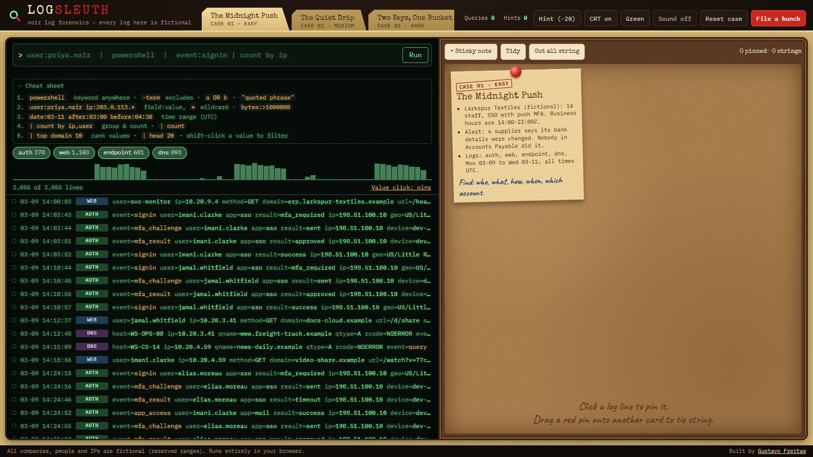
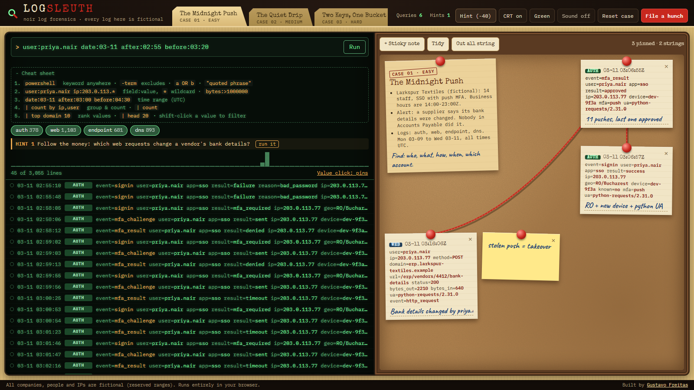

# LOGSLEUTH

A noir detective game where you crack fictional breaches by actually querying the logs.

**[Live demo](https://tootenramen.github.io/LogSleuth/)**

## What you can do

- Work three cases (easy, medium, hard): an MFA-fatigue account takeover, a slow DNS-tunnel exfiltration, and a malicious insider hiding behind a colleague's access key.
- Query 3,000 to 4,600 generated log lines per case (auth, web gateway, endpoint, DNS, cloud audit) with a small real query language: keywords, `field:value`, wildcards, numeric compares, time ranges, `| count by`, `| top`, `| head`, with autocomplete.
- Pin the decisive lines to a cork corkboard, drag the cards, tie red string between them (it wobbles when you pull it), and scribble notes.
- File a hunch (who, what, how, when, which account). You get a verdict, a breakdown of what you got right and missed, and the 2-3 lines that gave it away.
- Hints are tiered and cost points. Score rewards accuracy, evidence quality and fewer queries.

## How it works

Everything runs in your browser. Each case is generated deterministically from a seeded PRNG, with noise and red herrings (password spray, legitimate travel, regular agent beacons, big nightly backups). The query bar is a hand-written tokenizer, parser and evaluator, with no `eval`. Progress is saved in `localStorage`; nothing leaves the page. All companies, people and IPs are fictional (RFC 5737 ranges, `.example` names).

## Skills this shows

Detection-engineering instincts (impossible travel, MFA fatigue, rare parent/child processes, beaconing jitter, DNS tunnelling, access-key abuse), parser and query-engine design, interactive SVG/DOM UI, accessible and responsive front-end.

Built by Gustavo Freitas - [LinkedIn](https://www.linkedin.com/in/gustavo-freitas-69b93910b/) - [more projects](https://github.com/Tootenramen)
